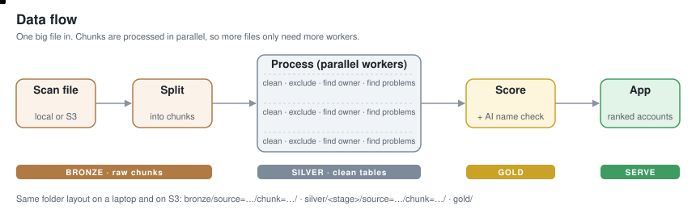
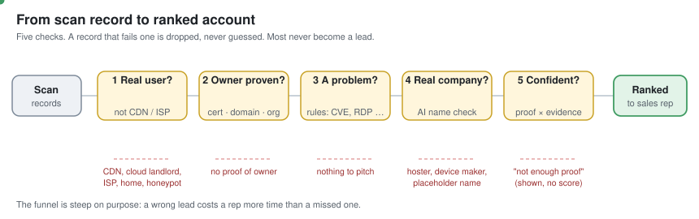

# Cyber Sales Intel

**Find, rank and pitch companies that have visible security problems on their internet-facing servers.**
Built from Shodan-style internet scan data for the sales team of a cybersecurity software company.

**Live app:** https://sales-intel-wgbpzzn9khttipxii3r6rq.streamlit.app/ (no login, no API keys, no AI calls at view time)

> **Scope of this proof of concept.** The input is one scan file of 13.5 million records (18 GB compressed).
> The app and every number below come from its **first 500,000 records** (one of its 27 parts).
> The [orchestrator](orchestrator/README.md) that splits and processes the whole file, locally or on S3, is built and
> tested end-to-end on a small sample and against a fake S3 client; it has not yet been run on the full file or on real AWS.

---

## What a sales rep gets
| Rep question | What the app shows |
|---|---|
| Who do I call this week? | A ranked list of companies, filterable by country, problem type and confidence, with CSV export |
| Why this company? | Their top problems in plain words, how serious each is, and on how many servers |
| What do I pitch? | The product to offer for each problem, why the customer should care, and a suggested opening line |
| Can I trust it? | A confidence score, computed live from the evidence and explained as two questions. Weak cases show "not enough proof" and no score |
| What exactly did you see? | Every finding: server IP, port, problem, technical detail and date seen |

## How it works





**The data is not company data.** One record is one open port on one IP address at one moment, with the
banner and parsed service details. To turn that into sales leads, the pipeline answers five questions in order:

1. **Is the owner of this IP the real user?** CDN/WAF vendors, cloud landlords, ISPs, home connections,
   honeypots and security vendors are excluded first. A problem on a Cloudflare edge is not Cloudflare's customer's
   problem, and an ISP is not the prospect. Lists and name rules: `config/exclusions.yaml`.
2. **Can we prove who owns it?** Three kinds of proof, strongest first:
   **A** the TLS certificate names the organisation · **B** all hostnames point to one company domain ·
   **C** the IP registry organisation (only where the network isn't a hoster or cloud).
   Default device certificates, placeholder names, reverse-DNS names and hosting domains don't count as proof.
   When two independent proofs name the same company, confidence goes up. With no proof, the record is dropped.
3. **Is there a security problem?** Fixed, readable rules (`config/findings.yaml`):
   known CVEs (extra weight for known-exploited ones), remote desktop / file sharing / databases / WinRM / Telnet / VNC
   open to the internet, end-of-life software or OS, out-of-support Exchange, outdated TLS, expired or self-signed certificates.
4. **Is the owner a real company?** An LLM labels each unique owner name once (offline, cached) as
   *company / infrastructure / default / unknown*. This removes hosting firms and device makers whose names are printed
   on certificates of boxes they sold (a NAS maker's certificate on a customer's NAS is not the NAS maker's server).
5. **Are we confident enough?** `confidence = owner proof × evidence strength`. Below 0.5 the app says
   "not enough proof" instead of guessing.

**Score** (only for accounts that pass): for each problem type, `severity (0–10) × log2(servers + 1) × recency`,
summed. More servers add points with diminishing returns, so one critical hole isn't drowned out by 50 expired certificates.
Recency halves every 30 days. The same IP + port seen again in a later scan counts once (latest sighting wins).

## What is rules, what is AI, what is ML
| Part | Method | Why |
|---|---|---|
| Exclusions, ownership proof, findings, score | **Rules** in YAML | Auditable: every rank can be traced to config lines and evidence rows |
| Owner-name clean-up | **LLM** (Groq, `openai/gpt-oss-120b`), offline | The long tail of hosting firms and device makers can't be hand-listed; hand-made lists stopped converging after several rounds of review |
| Confidence | **Computed** per account from its own evidence rows, live in the app | Never a constant per level |
| Machine-learning model | **None** | There are no outcome labels (won/lost deals) to train on; a model would only learn our own rules back |

Guardrails on the LLM step (`pipeline/classify.py`): fixed JSON answer format checked against the allowed labels,
temperature 0, answers cached by `hash(prompt version, model, name)`, missing or invalid answers fall back to `unknown`
(and are retried next run), cost logged per run (`logs/llm_cost.csv`), calls paced to stay under the provider's tokens-per-minute limit
(a 429 is retried after the time the API asks for), accuracy measured on a separately labelled gold set.
The prompt examples are checked to contain no gold-set names. Details and costs: [docs/LLM_USAGE.md](docs/LLM_USAGE.md).

## Results
Measured with `eval/eval_orgs.py` against a gold set of owner names (`eval/gold_orgs.csv`): the top-ranked accounts
plus a random sample, each labelled company / infrastructure / default / unknown.

**The funnel** (first 500,000 records):

| Step | Count |
|---|---|
| Scan records → unique IP + port | 500,000 → 463,491 |
| Problems found on servers with a proven owner | 15,262 |
| Problems kept after the LLM name check | 14,683 |
| Accounts (companies) | 6,818 |
| Ranked (confidence ≥ 0.5) / "not enough proof" | 489 / 6,329 |

**Quality** (96 gold names with a definite label; 14 more are labelled "unknown" and left out):

| Measure | Rules only | Rules + LLM |
|---|---|---|
| Real companies in the top 25 accounts | 10 | **15** |
| Name labels matching the gold set | 0.55 | **0.87** |
| Junk names removed (recall) | n/a | 0.77 |
| Removals that were right (precision) | n/a | 0.94 (2 real companies wrongly removed) |

LLM cost for this run: 772 owner names, 21 calls (one retry for 6 names a rate limit had left unanswered), about $0.05 at the prices in `config/llm.yaml`.
The gold labels were drafted with AI help and **have not yet been reviewed by a person**, so these numbers are provisional.
Full method and history: [docs/EVALUATION.md](docs/EVALUATION.md).

## Scale: hundreds to thousands of files a month
The input is one large file (13.5M records, 18 GB compressed), and many such files arrive every month.
The [orchestrator](orchestrator/README.md) treats every file the same way:
- **land**: the file arrives in the landing ("master") folder for its date and source, and is never changed there;
- **split**: streams it into part files of 500,000 records (27 parts for this file), never fully unpacked;
- **process**: runs ingest → exclude → find owner → find problems on every part in parallel workers; each part is independent and restartable;
- **score**: reads the small findings of all files, removes repeat sightings, and publishes the two files the app reads.

The same code runs on a laptop folder or on **S3**: one line in `config/orchestrator.yaml`, plus a normal AWS login.
In production an S3 upload event or a daily cron calls `run --pending`; several containers can run `process` side by side,
and `score` runs once a day. Volume only affects split and process, which scale by adding workers.
LLM cost grows only with **new** owner names, because answers are cached.
No Spark or Airflow needed: one 500,000-record part was processed within a 4 GB DuckDB memory cap (ingest took 12.6 s).

## Storage layout (the same on a laptop and on S3)
One root holds everything: `data/lake/` locally, or the S3 bucket (`s3://<bucket>/`, optionally under a prefix).
Below the root the paths are identical. Folders are Hive-style (`name=value`), so DuckDB, Athena or Spark read
`dt`, `source` and `file` as columns and only open the folders a query needs.

```
<root>/                                     local: data/lake      S3: s3://<bucket>
├── landing/                                the "master" folder: original files arrive here, never changed
│   └── dt=2026-11-01/source=shodan/
│       └── sample_assignment.json.zst      18 GB, 13.5M records
├── bronze/                                 the file split into parts
│   └── dt=2026-11-01/source=shodan/file=sample_assignment/
│       ├── part-00000.json.zst             500,000 records each
│       └── … part-00026.json.zst           (27 parts)
├── silver/<stage>/                         clean tables, one Parquet per part per stage
│   └── dt=2026-11-01/source=shodan/file=sample_assignment/part-00000.parquet …
│         observations  one row per IP + port
│         eligibility   + excluded / needs proof / eligible
│         attribution   + owner, and how it was proven
│         findings      one row per IP + port + problem
├── manifest/                               bookkeeping, same partitions
│   └── dt=2026-11-01/source=shodan/file=sample_assignment/
│       ├── _split.json                     size, sha256, records, parts, time of the split
│       └── part-00000.done.json …          part finished + row counts (reruns skip it)
└── gold/                                   what the app reads
    ├── dt=2026-11-05/                      snapshot for each scoring day
    └── latest/                             accounts.parquet, account_findings.parquet → copied to data/out
```

| Partition | Meaning | Why |
|---|---|---|
| `dt=YYYY-MM-DD` | date the file belongs to | daily processing and clean-up by day; `dt` (not `date`) because `date` is a reserved word in Athena/Hive SQL |
| `source=<name>` | data provider / feed, lowercase | several feeds can share one lake |
| `hr=HH` | hour (optional) | off by default. `layout.use_hour` switches it on **for the whole lake**: mixed depths would break Hive readers |
| `file=<file id>` | landed file name without extension | several files per source per day must not overwrite each other's parts |

**Meta details** the orchestrator needs for each file: `dt`, `source`, `file` (plus `hr` when hours are on).
It builds every path from these. Pass them as flags, as a JSON file (`--meta`), or use `--pending` to pick up every landed file
that is not fully processed yet.

**Raw data is kept twice on purpose:** `landing/` holds the file as delivered and `bronze/` holds the same records as parts,
copied byte-for-byte. Silver keeps only the fields today's rules use; anything else (raw banner, JARM, certificate hashes…)
stays in bronze and can be added to silver later by rerunning `process --force`. In production on S3, a lifecycle rule
can move `landing/` to cheap archive storage after N days; `_split.json` keeps the size and sha256 that tie the parts to it.

**Reruns:** `split` is skipped when `_split.json` exists, `process` skips parts with a done marker, and `score` always
rebuilds gold (seconds; the LLM is only called for owner names not in the cache).

## Run it
```bash
pip install -r requirements.txt
cp .env.example .env            # optional: GROQ_API_KEY for the LLM step

# put the file into landing, then split + process + score (local folder; add --storage s3 for S3)
python -m orchestrator land --input /path/to/sample_assignment.json.zst --dt 2026-11-01 --source shodan
python -m orchestrator run  --dt 2026-11-01 --source shodan --file sample_assignment.json.zst
python -m orchestrator run  --pending           # or: everything landed and not finished yet
python -m orchestrator status

python eval/eval_orgs.py        # quality check against the gold set
streamlit run app/app.py        # the app (reads data/out only)
pytest -q                       # tests
```
`python -m orchestrator score --dry-run` shows how many owner names the LLM step would label (and pay for) before running it.

## Repository map
| Path | What |
|---|---|
| `orchestrator/` | split / process / score / run, local or S3 ([usage](orchestrator/README.md)) |
| `pipeline/` | one file per stage (`ingest`, `eligibility`, `attribute`, `findings`, `classify` (LLM), `score`); each handles one part file and is called by the orchestrator |
| `config/` | every rule and setting: exclusions, findings, scoring, LLM, app text, orchestrator |
| `app/app.py` | Streamlit app (reads `data/out` only) |
| `eval/` | gold set and evaluation script |
| `prompts/` | LLM prompts (versioned) |
| `tests/` | unit and end-to-end tests (fake S3 and fake LLM: no network needed) |
| `docs/` | decisions, data profile, signals, evaluation, LLM usage, diagrams |
| `DEV_LOG.md` | mistakes made while building, how each was caught, and the effect of each fix |

## Known limits
- **This proof of concept covers the first 500,000 of 13.5 million records.** Account counts and the ranking will change when the whole file is processed.
- **Ownership is proven, not guessed**, so many real companies on cloud servers without a naming certificate or domain are left out. That's deliberate: a wrong lead costs more than a missed one.
- **CVE findings come from software versions** the server reports, not from tests; the customer may already have patched. The app says so and gives these less weight.
- **One scan is one moment in time.** Recency and "new since last scan" only become useful once several files have been loaded.
- **The gold set is small** (about a hundred names), so quality numbers carry wide error bars.
- **No contact data.** Contact enrichment is out of scope; the app gives the company, domain, country and evidence.
- **Some device makers still slip through** the LLM check (e.g. software vendors whose names appear on their customers' default certificates).

More: [docs/DECISIONS.md](docs/DECISIONS.md) · [docs/SIGNALS.md](docs/SIGNALS.md) · [docs/DATA_PROFILE.md](docs/DATA_PROFILE.md) · [docs/EVALUATION.md](docs/EVALUATION.md)
